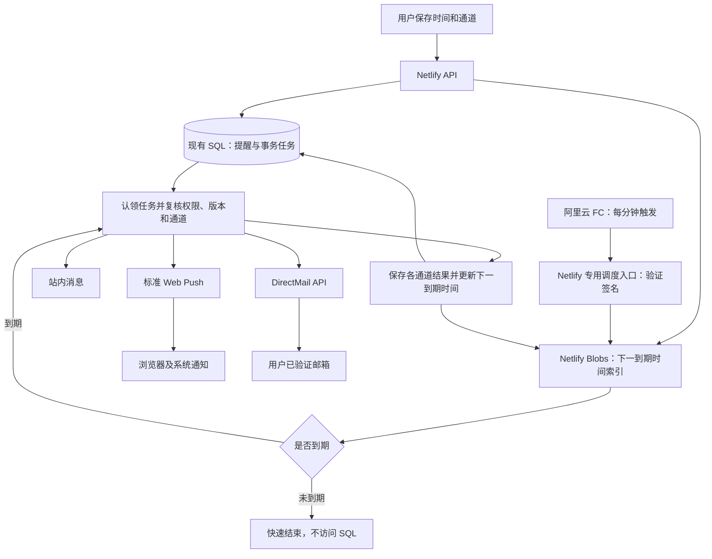

# 校园阅览室：阿里云定时与双通道提醒实施计划书

版本：1.0 · 编写日期：2026-10-21 · 状态：方案完成，尚未实施

## 一、项目目标与已确认决策

保留现有 Netlify 网站、登录系统和数据库，新增阿里云函数计算 FC 作为定时调度入口，接入 DirectMail 发送邮件，沿用网站现有的标准 Web Push。用户可以选择浏览器通知、邮件提醒，或同时开启两种方式。

已确认：网站和数据库不迁移；FC 负责定时调度；公告仍在提醒中心逐篇设置时间；“学校与关键词”不恢复。当前这份交付仅为计划书，不代表服务已配置、已开发或已上线。

以下是本计划的建议默认值，可在实施评审时调整：首版邮件使用当前账号经过验证的邮箱；邮件默认关闭；提醒时间继续按北京时间展示；试运行先限制邮件发送量，再按实际使用调整。

交付目标是按设定分钟检查并发起发送。浏览器、操作系统、邮件服务、设备网络可能产生延迟，服务端发出时间与用户实际看到时间分别记录。

## 二、现状与第一版范围

### 2.1 可以复用的现有能力

本地代码已具备公告选择、关键词搜索、标签筛选、逐篇设时、站内消息、日历导出、浏览器订阅、Service Worker、任务版本和设备发送记录。每账号最多100条提醒、5个浏览器，提前7天、3天、1天和到时等档位继续沿用。

当前实现使用 QStash 延时登记和回调，邮件功能尚不存在。旧方案参考 [网页提醒说明](web-reminders.md) 和 [分钟提醒评估](minute-reminders-evaluation.md)。本计划替代其后续调度路线，历史文档保留为实施依据；文中的旧发布状态不作为本次线上核验结果。

### 2.2 第一版交付内容

- 浏览器推送和邮件分别设置开关，支持单通道使用。
- 每篇公告分别设置时间、提前档位及发送方式。
- 账号邮箱验证、发送测试邮件、关闭邮件提醒。
- FC 每分钟触发；到期任务由现有网站后台处理。
- 两个通道分别显示等待、服务商已接收、失败或结果未知。
- 改期、取消、权限变化、重试、重复触发和服务中断恢复。
- 配置指南、运营用量记录、回滚步骤和真机验收记录。

第一版不增加自动新公告群发、短信、微信、原生 App 或 AI 提取日期。这些属于后续扩展；现有站内消息和日历导出继续可用。

## 三、用户操作与页面呈现

### 3.1 账号及设备设置

提醒中心顶部保留紧凑设置区，提供“浏览器通知”和“邮件提醒”两个独立入口。

浏览器通知按设备开启，继续使用系统授权流程；关闭当前设备只解绑当前设备。邮件按账号开启，显示脱敏邮箱及验证状态，并提供测试、暂停和关闭入口。

首版优先使用当前账号的登录邮箱，不提供填写任意收件人的接口。实施时必须从身份服务获取可信验证状态：现有网关仅透传邮箱，不能据此假定已经验证；若取不到可信状态，增加一次确认邮件流程。验证链接短时有效、单次使用并绑定账号，验证后仍需用户主动开启邮件提醒。

修改邮箱后重新验证，旧地址停止接收后续提醒。邮件关闭立即约束后续发送；已经被服务商接收的邮件无法撤回。若需要验证邮件，建议每账号每天最多3封、重发间隔至少60秒，这些发送也计入额度。

### 3.2 每篇公告的时间设置

1. 从公告列表或提醒中心右侧选择公告，加入“待设置时间”。
2. 分别填写该公告的事项名称、北京时间及提前档位。
3. 勾选“浏览器通知”“邮件提醒”，可以只选一种或两种都选。
4. 保存后显示时间、选定通道和后台登记状态。
5. 未开启设备或邮箱未验证时，明确提示对应通道尚未就绪；可以继续保存事项。

两种外部通道均关闭时，允许仅保存站内提醒和日历事项，不显示“系统提醒已开启”。浏览器权限被拒绝不影响已就绪的邮件；邮件失败不影响浏览器推送。

新账号邮件默认关闭。已有用户保留有效的浏览器订阅，所有历史事项的邮件默认关闭。新事项可沿用用户已选择的通道偏好；开启账号邮件不会自动给历史事项群发或补发。

### 3.3 消息内容和状态

浏览器通知沿用通用提示，点击进入登录后的提醒中心。首版邮件建议使用“校园阅览室｜你有一条到期提醒”，正文包含设定时间、通用说明、查看入口和关闭邮件入口，不默认附带公告标题、正文或 AI 摘要。

浏览器显示“推送服务已接收”，邮件显示“邮件服务已接收”；两者均不直接写成“用户已收到”。只有获得可信投递反馈时才补充对应状态；进入收件箱、设备弹出和用户阅读是不同结果。

## 四、整体架构

FC 只携带时间、请求编号和签名调用网站后台，不读取账号、公告、邮箱、数据库连接或推送端点。DirectMail 凭据和 Web Push 私钥放在 Netlify 生产环境的 Functions 范围。网站继续承担权限检查和发送业务。

FC 使用一个分钟周期触发器，避免为每篇公告创建云资源；官方支持按分钟设置时间间隔。具体地域先验证到 Netlify 的连接质量，再固定配置。[FC 定时触发器](https://help.aliyun.com/zh/functioncompute/time-triggers)

这条链路仍包含 FC 到 Netlify、Netlify 到邮件及浏览器厂商服务的网络请求。国内云账号方便管理调度和发信，但原有网站的可达性、跨区域网络及浏览器推送通道仍需实测。

### 4.1 必须先解决：避免分钟轮询 SQL

现有数据库默认空闲5分钟后休眠。每分钟直接查询会阻止休眠，空闲时也持续消耗计算额度；将定时器换到阿里云本身不会消除这部分成本。[Netlify 休眠机制](https://docs.netlify.com/build/data-and-storage/netlify-database/configure-sleep-on-inactivity/)

本计划新增 Netlify Blobs 轻量索引，最少保存下一次需要处理的时间和版本，时间计算需同时考虑到期任务及允许重试的任务。已完成、过期或等待人工处理的未知结果不持续占据最早时间。每分钟入口先读索引，尚未到期则结束，仅在有到期任务、登记修复或正常用户操作时访问 SQL。

实施要求：

- SQL 是业务数据的唯一依据；提醒与待登记任务在同一事务保存。
- 事务提交后登记下一到期时间。登记完成前，前端显示“待登记”或“登记失败”，不能显示已生效。
- 新增或提前事项只允许安全地把索引推进到更早时间；取消后允许保留旧的较早唤醒，醒来复核后再更新。
- 到期处理结束后重新计算后续时间。并发保存和消费使用强一致读取及 ETag 条件写，不能覆盖另一请求刚登记的更早任务。
- 索引写失败、超时或结果不明时保留待修复状态，验证读回结果；不得把异常当成登记成功。
- 索引丢失或服务不可用时返回故障，触发告警及受限修复，不自动降级为每分钟扫描全库。
- 保留每日09:00、20:00低频修复，用于发现登记中断；它不是正常分钟送达的依赖，也不能使未成功登记的事项获得准时保证。

Netlify Blobs 提供条件写入能力，但本项目仍需锁定并验证所用 SDK 版本、强一致读取、并发行为及失败返回，完成原型后才进入正式实现。[Blobs API](https://docs.netlify.com/build/data-and-storage/netlify-blobs/)

此设计减少空闲 SQL 唤醒，不能保证数据库一定休眠：若用户访问或提醒足够密集，数据库仍可能长期活跃。现有 Free 计划公开上限为每账期48数据库计算单位，必须计入容量验收。[数据库额度](https://docs.netlify.com/build/data-and-storage/netlify-database/billing-and-usage/)

## 五、可靠性、权限与数据改造

### 5.1 调度入口

拟新增独立的生产调度入口，例如 /.netlify/functions/reminder-tick，与浏览器登录 API 分离。FC 请求使用 HMAC 签名，绑定 HTTP 方法、固定路径、时间戳、请求编号和原始请求体摘要，校验有效时间窗并支持密钥轮换。

只接受固定生产站点、固定方法和有限长度请求体，不接受请求方指定账号、收件人、回调地址或公告内容。验签失败在访问 SQL 前拒绝。重复触发由任务认领和通道回执保证幂等；不能假设调度一定只执行一次。

签名只是调用授权，不代替业务权限。真正发送前重新检查事项版本、取消状态、公告可读权限、设备归属、邮箱验证及通道开关。

### 5.2 任务和通道分别记账

复用现有任务表，新增调度提供方及必要状态；浏览器和邮件分别保存发送结果。一个任务只有在所选通道均已结束、取消或明确过期后才完成，不能先发浏览器就把邮件标记为完成。

邮件回执唯一键建议包含“任务编号、通道、收件地址绑定版本”。只保存需要的服务商编号和结果；错误日志不写完整邮箱、密钥或公告正文。

必须改造现有“有浏览器设备才创建/登记任务”和“队列及 Web Push 同时配置才就绪”的判断。仅开启邮件的用户也应正常登记；VAPID 未配置不得使 DirectMail 自动失效，反向亦然。

当前 QStash 的6天滚动窗口、每天400次预约保护不直接套用到 FC。远期提醒沿用产品允许范围，取消和改期仍以任务版本失效，邮件配额单独核算。

### 5.3 重试与中断恢复

- 下一次分钟触发继续认领尚未完成的到期任务，使用租约及有限批次；不能因单个用户任务多而长期阻塞其他用户。
- 明确的临时失败采用有限退避重试；无效设备、无效地址或永久拒绝停止重试。
- 请求超时且无法判断服务商是否接收时，记为“结果未知”，不盲目重发；系统不承诺外部服务严格只投递一次。
- 迟到任务采用明确补偿窗口，建议沿用24小时；超过窗口只保留历史记录，邮件和浏览器均不突然补发大量过期提醒。
- 站内已读不吞掉待发的浏览器或邮件；两个外部通道也互不吞掉。
- 退信、投诉通过 DirectMail 支持的可信反馈或查询流程处理，硬退信地址暂停发送并提示用户。邮件服务接收成功后仍可能退信。

### 5.4 数据迁移与预览隔离

仅新增迁移，已提交的六份迁移文件保持不变。新增内容包括账号邮件偏好与验证版本、逐事项通道设置、邮件发送回执和发送量计数；具体字段在实现评审时确定。

升级只登记仍在未来且有效的事项。历史邮件默认关闭；不重新发送已完成通知。预览环境使用合成账号及发送桩，不接入生产凭据、生产索引或真实收件人。生产索引用站点级命名空间，避免部署切换清空；预览与生产明确隔离。

## 六、账号、域名和配置准备

### 6.1 站点所有者准备

1. 已实名认证的阿里云账号，开通 FC 和 DirectMail；开通不等于同意购买资源包或自动续费。
2. 一个位于本人或团队管理下、可修改 DNS 的域名。可使用专门的发信子域名，例如 notify.example.com，避免影响已有邮箱。
3. 在选定 DirectMail 区域创建发信域名和地址，按控制台要求完成 DNS 验证。同一区域的地址必须配合同区域接口使用。
4. 分别指定可用于验收的 QQ、163、Outlook 或其他实际邮箱，以及 Windows、iPhone/iPad、安卓测试设备。
5. 设置阿里云和 Netlify 用量告警，确认试用是否领取、抵扣范围及账单地区；没有可验证的抵扣权益时按付费测算。

域名、DNS、实名和发信配置属于上线依赖，不能用当前 netlify.app 二级域名直接代替可控的发信域名。[DirectMail 开通与配置流程](https://help.aliyun.com/zh/direct-mail/getting-started/simplified-procedure-of-sending-by-api-and-smtp)

### 6.2 建议环境变量

以下是拟新增名称，最终以实现文档为准，不代表目前已经存在。

Netlify 生产 Functions：

- REMINDER_SCHEDULER：aliyun-fc，调度提供方。
- REMINDER_TRIGGER_SECRET、REMINDER_TRIGGER_SECRET_NEXT：FC 调用验签及轮换。
- DIRECTMAIL_ACCESS_KEY_ID、DIRECTMAIL_ACCESS_KEY_SECRET：专用 RAM 身份凭据。
- DIRECTMAIL_REGION、DIRECTMAIL_ACCOUNT_NAME、DIRECTMAIL_FROM_ALIAS：区域及发件信息。
- REMINDER_EMAIL_ENABLED、REMINDER_EMAIL_DAILY_LIMIT：邮件总开关及应用发送量保护。
- 已有 WEB_PUSH_PUBLIC_KEY、WEB_PUSH_PRIVATE_KEY 继续使用，无需重新生成。

FC 环境：

- REMINDER_TICK_URL：固定生产调度入口。
- REMINDER_TRIGGER_SECRET：与网站当前验签密钥对应。
- 有限超时、有限重试和最小实例数0的运行配置。

运行身份只授权实际需要的 DirectMail 发信及反馈接口，服务开通和运行权限分开，不把主账号全量密钥交给程序。凭据由持有者填入控制台，不放进源码、前端变量、计划书或聊天。

## 七、费用与容量规划

核对日期：2026-10-21。以下是公开规则和估算，不是本人账号的实际账单，也不是固定报价。

### 7.1 FC 调度

每分钟一次，30天约43,200次，31天约44,640次。FC 当前对存在调用或资源占用的 CPU 函数设有每小时0.01元最低消费；单个函数全天候运行，未计试用及资源包抵扣时，按该规则推算30天至少约7.20元、31天约7.44元的 CU 费用。实际消耗更高则按实际计费，公网流量、日志另算。

实例默认延时释放可能产生浅休眠资源用量，不能只用请求执行秒数估算，也不能把7.20元当作总费用上限。不使用已标注在2026年8月结束的历史折扣来压低预算。[FC 当前计费](https://help.aliyun.com/zh/functioncompute/billing-overview-of-fc)、[最低消费与延时释放说明](https://help.aliyun.com/zh/functioncompute/product-change-description-on-optimizing-function-billing-mode)

### 7.2 DirectMail

公开按量价格为2元/1,000封；每个主账号累计2,000封免费额度，每天最多免费200封。免费额度不是每月重置，验证、测试及可能计费的失败发送也需要核算。

例如未计免费抵扣时，每月1,000封约2元、5,000封约10元。发送给两位收件人算两封；同一事项开启多个提前档位也会增加发送量。[DirectMail 计费](https://help.aliyun.com/zh/direct-mail/billing-methods)

### 7.3 现有平台与域名

每分钟调用 Netlify 仍产生约4.3万次/月的后台请求及索引读取，Netlify 的计算、请求、存储和数据库用量共用现有额度。到期频繁时 SQL 成本会上升；Blobs 不是无成本方案。

域名购买及续费单独核算。首版暂不购买独立 IP、云服务器、额外数据库或预置实例。若先使用免费额度，仍要给额度用尽后的账单留预算。

### 7.4 建议试运行保护

- 阿里云设置20元/月预算告警，作为初始观察线；预算告警并非硬性消费封顶，也不是用户已批准的固定预算。
- Netlify 额度使用达到70%时复核本账期剩余容量。
- 试运行邮件建议全站150封/日、每账号20封/日，验证、测试和重试一起计入；达到应用上限时明确显示暂停或受限，不影响站内提醒及可用的 Web Push。
- 日限额使用事务计数防止并发超发。阿里云账号若另有应用发信，也会消耗共享额度，应用限额不能保证账号整体账单为零。
- 上线先观察24小时空闲调度及7天实际提醒用量，再估算整月；不自动升级付费套餐。

## 八、实施阶段、协作与交付物

工作量初估5—8个开发工作日，不含实名审核、DNS 生效、平台审批和7天试运行观察。它是评审用估算，不是承诺完成日期。

### 阶段一：调度与费用原型（约1—2日）

负责人A主做，B评审：验证 FC 到 Netlify 的连接、签名入口、Blobs 强一致/条件写、并发提前事项和空闲不查询 SQL。输出原型证据、依赖版本和24小时调度测量方法。

通过标准：索引并发及失败恢复可验证；空闲 tick 不创建数据库连接；所需 Netlify 请求与存储用量符合试运行容量。若达不到，先修订方案，不直接启用每分钟 SQL 扫描。

### 阶段二：双通道与邮件（约2—3日）

负责人B主做页面、偏好和邮箱验证，A主做 DirectMail 适配和通道回执，互相评审。完成仅邮件、仅浏览器、两者同时、两者关闭四种状态，以及关闭、改期、取消、限额和退信处理。

输出数据迁移、接口变更、页面预览、合成回归记录及配置指南。邮件 API 首选官方 SDK 的 HTTPS 接口，不采用浏览器直连或公开 SMTP 代理。[SingleSendMail](https://help.aliyun.com/en/direct-mail/singlesendmail)

### 阶段三：联调与切换（约1—2日）

完成 FC 调度与两个发送通道联调，将当前 QStash 专属判断替换为调度适配层。生产同一时刻只允许一个提供方认领并执行任务，不能让旧回调与 FC 同时发送。

当前提醒分支可作为开发起点，不需要先把纯 QStash 版本上线。提醒相关改动按可评审的 PR 组织；两位协作者均可审核和发布，沿用互审约定，不在写计划书时合并现有 PR。

### 阶段四：真机验收与上线准备（约1日）

双方共同完成测试清单，站点所有者完成账号和生产配置；发布负责人在审核通过后操作。交付可复现配置步骤、各端验收记录、故障停用和回滚说明。

发布后另做7天观察，核对调度缺口、发送结果、退信及两家平台用量，再决定是否扩大用户规模。

## 九、验收标准

### 功能与权限

- 仅邮件且没有浏览器订阅的账号仍能收到测试提醒；邮件未开启时不发邮件。
- 每篇公告单独设时；新用户及历史事项不被默认订阅邮件。
- 改期或取消后，旧版本任务不再发出新的请求；已被服务商接收的通知不作可撤回承诺。
- 其他账号不能查询、修改或接收本人的提醒；公告权限撤销后不外发其内容。
- 重复触发、站内已读、多设备、邮箱变更和设备换号均不造成误发。

### 调度与恢复

- 正常联网和无积压条件下，至少100个合成到期任务的“预定时间至服务端发起发送”P95不高于120秒，作为试运行目标，需实测确认。
- 暂停调度数分钟后恢复，能处理窗口内积压，并保持任务与通道幂等。
- SQL 已提交但索引写失败、条件写冲突、索引丢失、服务商超时等故障均有明确状态和恢复路径。
- 任务密集时有有界批次及公平处理；超过试运行吞吐量时报告积压，不能仍宣称所有事项准点。

### 真实送达

- Windows Chrome/Edge、iPhone/iPad 主屏幕网页应用、支持 Web Push 的安卓浏览器分别在关闭页面后测试。
- 每种纳入支持的设备环境至少记录10次测试：预定时间、服务端时间、服务商结果和设备显示时间；不以浏览器模拟手机替代真机。
- 至少两家实际邮箱服务测试正常收信、垃圾箱、关闭邮件及无效地址处理。邮件 API 成功不能直接算“已进入收件箱”。
- iPhone/iPad 仍需满足系统版本、添加到主屏幕及通知授权要求；阿里云调度不能改变浏览器和系统限制。[Apple Web Push](https://developer.apple.com/documentation/usernotifications/sending-web-push-notifications-in-web-apps-and-browsers)

### 回归与成本

- 公告读取、搜索、标签、收藏、日历、登录和现有 AI 使用规则通过回归。
- 预览不发真实邮件和推送；密钥不进入产物或日志。
- 24小时空闲测试中，分钟 tick 不唤醒 SQL；正常用户操作及低频维护单独统计。
- 核对 FC、Netlify、DirectMail 实际用量与预算，不以纸面单价代替实际计费验证。

## 十、发布与回滚

发布前先完成数据迁移兼容、生产凭据配置和受控测试，再开启 FC 分钟触发及邮件总开关。仅有代码发布、调度请求成功或服务商接收，均不足以宣布三端真实提醒已完成。

切换时先停用旧调度并等待在途任务，使用提供方标识、任务版本及通道回执屏蔽旧回调；再开启 FC。更新文档和界面中的 QStash 配置入口，避免用户继续填错变量。旧凭据在确认切换稳定后移除，不在切换前销毁。

出现问题时，可分别关闭邮件总开关或 FC 触发器，保留站内提醒、日历及已保存事项，界面显示暂停状态。数据库新增字段和回执不回删；回滚代码也不能重新开放邮件或重复消费旧任务。

QStash 只有在实际配置并验证过、与新通道数据兼容时才能作为回退调度；当前不能假定它已经可用。否则回退到明确标记的站内与日历模式，修复后再恢复外部发送。

本计划的下一项实施工作是阶段一原型验证。需准备的外部资源为阿里云账号、可控发信域名和验收设备；购买及正式发布另按实际授权执行。
